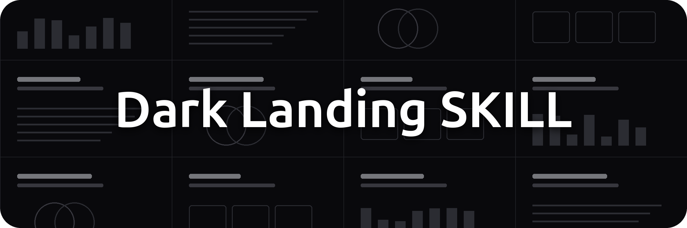

<div align="center">

<p align="center">
  
</p>

<p align="center"><a href="README.md">English</a> | <b>日本語</b></p>

<h1 align="center">Dark Landing SKILL</h1>

<h3 align="center">細い罫線で区切るダークなランディングページを作る Claude Code スキル。</h3>

<p align="center">黒背景、全幅の 1px 罫線グリッド、ベントグリッド、ロゴ列、ユーザーの声、FAQ、CTA、フッターを組みます。文言・色・ロゴはすべて差し替え式です。React + Tailwind v4 + shadcn/ui が前提です。</p>

<p align="center">
  <a href="LICENSE"></a>
  <a href="https://tailwindcss.com"></a>
  <a href="https://ui.shadcn.com"></a>
</p>

<p align="center">
  <a href="#quick-start">Quick start</a> ·
  <a href="#作るもの">作るもの</a> ·
  <a href="#守ること">守ること</a> ·
  <a href="#検査">検査</a>
</p>

</div>

---

## 概要

`dark-landing` は Claude Code 用のスキルです。「ダークなベントグリッドのLPを作って」のように頼むと、決まった設計仕様に沿ってページを組みます。セクションは全幅の 1px 罫線で区切り、強調はアクセント色ではなく白と灰の明暗差で付けます。仮のロゴや架空のユーザーの声は置きません。

## 特長

- 9 セクション分のコンポーネント雛形（`assets/components/`）。
- 色・文字・余白・罫線・ボタンの数値仕様。
- 画面に出る文字はすべて `content.ts` から読み、コンポーネントに直書きしない。
- 色は意味トークン（`--background` `--foreground` `--muted-foreground` `--border`）だけで、ライトとダークの値を持つ。
- `scripts/lint.py` が、直書きの色、影、太い字、装飾グラデーション、仮の画像を検出する。

## Quick start

Claude Code がスキルを読み込む場所に置きます。

```bash
git clone <this repo> dark-landing-skill
ln -s "$PWD/dark-landing-skill" ~/.claude/skills/dark-landing
```

そのあと Claude Code で「ダークなベントグリッドのLPを作って」のように頼みます。

> [!NOTE]
> このリポジトリにはまだ remote がないため、clone の URL は `<this repo>` のままにしています。

## 作るもの

| # | セクション | 雛形 |
|---|---|---|
| 1 | Header | `header.tsx` |
| 2 | Hero | `hero.tsx` |
| 3 | Bento grid | `bento-grid.tsx` |
| 4 | Logo cloud | `logo-cloud.tsx` |
| 5 | Features | `feature-grid.tsx` |
| 6 | ユーザーの声（Wall of Love） | `wall-of-love.tsx` |
| 7 | FAQ | `faq.tsx` |
| 8 | CTA | `cta.tsx` |
| 9 | Footer | `footer.tsx` |

各セクションの構造と寸法は `references/sections.md` にあります。

## ファイル

| パス | 内容 |
|---|---|
| `SKILL.md` | 手順と規約 |
| `references/design-spec.md` | 色・文字・余白・罫線・ボタンの数値仕様 |
| `references/sections.md` | 9 セクションの構造と寸法 |
| `references/setup.md` | 依存と `globals.css` の導入 |
| `references/checklist.md` | 完成判定 |
| `assets/tokens.css` | 色トークン（ライト / ダーク） |
| `assets/components/*.tsx` | セクション雛形 |
| `assets/content.example.ts` | 差し替え用の文言定義 |
| `scripts/lint.py` | 規約の検査 |

## 守ること

- 色は意味トークンだけを使う。`#000` や `gray-500` は書かない。
- 区切りは影や角丸の面ではなく 1px の罫線にする。セルは隙間なく隣接させる。
- 強調は白と灰の明暗差で付ける。アクセント色は、指定があるときだけ使う。
- 仮のロゴ・仮のアイコンは置かない。ロゴ未指定ならサービス名の文字だけにする。
- 実在しない顧客ロゴ・ユーザーの声・数値を作らない。ダミーは「サンプル」と明記するか、素材を求める。
- 内側のスクロール領域には `overscroll-contain` を付ける。アニメーションは `prefers-reduced-motion` で止める。

## 検査

```bash
python3 -I scripts/lint.py ./src
```

違反があると終了コード 1 を返します。

> [!NOTE]
> 未検証: この README の作り直しでは、生成したページの表示と、実プロジェクトでの `scripts/lint.py` の実行は確かめていません。

## ライセンス

MIT
